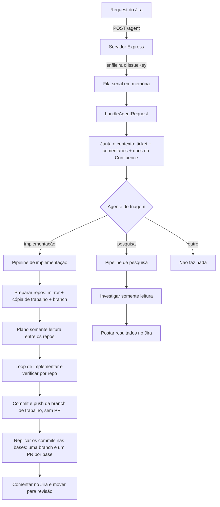
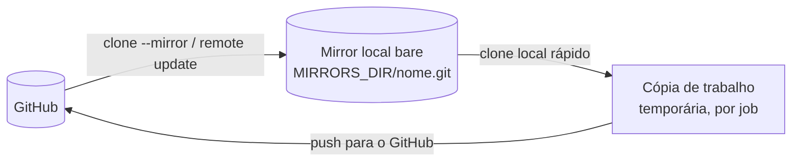

Design doc: cashme-agent — Automação de tickets do Jira em pull requests

Autor: Romulo Morais

Date: 20/07/2026

## Resumo

O cashme-agent é um serviço interno de automação. Ele transforma tickets do Jira 
em pull requests prontos para revisão. Para tickets de
investigação, ele responde com um resumo direto no próprio ticket.

O funcionamento é simples: o serviço recebe um webhook do Jira, junta o contexto
do ticket (descrição, comentários e páginas do Confluence vinculadas) e usa um
agente Claude para classificar o trabalho. Depois, ele implementa a mudança nos
repositórios relevantes, abrindo um PR por repositório, ou investiga a questão
e responde. Todo resultado volta para o ticket do Jira, e uma pessoa faz
a revisão final.

## Background

Colocar uma mudança pequena no ar as vezes pode dar mais trabalho do que deveria. O time
cuida de vários repositórios de front-end: o site institucional, os portais de
cliente e de parceiro, os simuladores em teste A/B, os design systems, entre
outros. Parte do trabalho do dia a dia é repetitiva e bem definida: pequenas
correções de bug, ajustes de texto e conteúdo e, principalmente, a mesma mudança
repetida em repositórios irmãos que compartilham o código (por exemplo,
cashmember e cashplayer, ou o par de simuladores A/B). Além disso, há os tickets
de spike/discovery, que só precisam de uma investigação, sem código.

Esse tipo de tarefa toma tempo do time sem ser difícil, e o trabalho manual de
repetir a mesma mudança em vários repositórios ainda é fácil de errar. As
ferramentas de IA prontas do mercado não resolvem bem o nosso caso: não são
integradas ao nosso fluxo no Jira, não entendem a relação entre os repositórios
irmãos, ou dão pouco controle sobre custo e hospedagem.

O cashme-agent nasce para automatizar esse caminho: do ticket bem descrito até o
PR pronto para revisão (ou até um comentário com a investigação), sempre com uma
pessoa como revisor final.

## Objetivos

- **Classificar automaticamente** cada ticket como *implementação*, *pesquisa*
  ou *outro*, e escolher os repositórios relevantes a partir de um catálogo.
- **Implementar em todos os repositórios relevantes** — para tickets de
  implementação, abrir um PR por repositório, incluindo os repositórios irmãos
  quando a mudança precisa ser replicada.
- **Verificar antes de abrir o PR** — rodar o build/testes do próprio
  repositório e tentar de novo um número limitado de vezes; só abrir o PR quando
  a verificação passar.
- **Pesquisar e responder** — para tickets de investigação, buscar no código e
  na web e postar um resumo curto e direto (em português) no ticket.
- **Fechar o ciclo no Jira** — comentar o resultado no ticket e movê-lo para o
  status de revisão.
- **Ser seguro por padrão** — fase de planejamento só leitura, cópias de
  trabalho isoladas e descartáveis, push sem sobrescrever e revisão humana antes
  do merge.
- **Ser guiado por configuração** — repositórios e prompts ficam em arquivos
  simples (`catalog.json` e os arquivos Markdown em `prompts/`), então dá para
  ajustar o comportamento sem mexer no código.

### Fora de escopo

- Não é um chatbot nem um assistente de conversa.
- Não faz merge de PR nem deploy — uma pessoa revisa e faz o merge.
- Não substitui o CI/CD; ele usa os checks que cada repositório já tem, em vez de
  defini-los.

## Design

O sistema é dividido nestas partes:

- Webhook e fila (entrada)
- Coleta de contexto do ticket
- Triagem / classificação
- Pipeline de implementação
- Pipeline de pesquisa
- Runtime do agente
- Camada de ferramentas
- Configuração

### Webhook & queue

A porta de entrada é um servidor Express com a rota `POST /agent` (e um
`GET /health` para health check). O Jira chama essa rota quando um ticket entra
no status configurado. A requisição traz a chave do ticket e é autenticada por um
header com segredo compartilhado (`X-Agent-Secret`).

Um mesmo ticket pode disparar vários webhooks, e o trabalho do agente é demorado.
Por isso, a requisição não é processada na hora. O handler valida o segredo,
coloca a chave do ticket na fila e responde `202 Accepted` na hora. Uma fila em
memória processa as chaves uma de cada vez (serial) e ignora as chaves que já
estão na fila ou em andamento. Isso mantém a concorrência simples e evita duas
execuções do agente no mesmo ticket ao mesmo tempo.

### Coleta de contexto do ticket

Antes de qualquer decisão, o serviço monta o contexto mais completo possível do
ticket, usando a API REST v3 do Jira:

- Resumo, descrição, tipo e autor do ticket.
- Todos os comentários (inclusive os da própria automação), convertidos do
  formato ADF do Jira para texto puro.
- Páginas do Confluence vinculadas — encontradas nos links do ticket e nas URLs
  citadas na descrição — buscadas e convertidas para texto.

Em tickets de spike/discovery, os requisitos reais costumam estar nos docs do
Confluence, e não no texto curto do ticket. Por isso, esse passo melhora bastante
a qualidade do resultado.

### Triagem / classificação

O contexto e o catálogo de repositórios são enviados para um agente Claude que
funciona como classificador de texto puro (sem ferramentas de arquivo). Ele
responde com um objeto JSON:

```json
{
  "taskType": "implementation | research | other",
  "repoNames": ["..."],
  "reason": "...",
  "userPrompt": "..."
}
```

O `repoNames` é resolvido contra o catálogo. O prompt de triagem já traz a nossa
regra de topologia: quando um repositório tem um irmão/duplicado que compartilha
o código, inclua todos, a não ser que o ticket cite apenas um.

### Pipeline de implementação

Para tickets de implementação, o pipeline tem quatro fases — cada uma em seu
próprio módulo em `src/operations/implementation/` (`prepare.ts`, `plan.ts`,
`implementRepo.ts` + `replicate.ts`), com o `index.ts` só orquestrando e
reportando:

1. **Preparar** — para cada repositório alvo, garante um clone `--mirror` local
   (ou atualiza), cria uma cópia de trabalho nova e cria uma branch a partir do
   ticket. Se um repositório falhar ao
   preparar, ele é registrado como falha e os outros seguem.
2. **Planejar** — uma execução do agente **só leitura** gera um plano curto de
   implementação, por repositório, cobrindo todos os repos preparados.
3. **Implementar e verificar** — cada repositório é implementado por um agente
   que edita a cópia de trabalho e roda o build/testes do próprio repositório.
   Ele tenta de novo até `MAX_VERIFY_ATTEMPTS` vezes, até a verificação passar. O
   diff de cada repositório pronto é passado como dica para os repositórios
   irmãos, para as mudanças replicadas ficarem consistentes. Quando dá certo, as
   mudanças recebem commit (mudança só de lockfile é revertida quando não houve
   mudança de dependência) e a branch de trabalho é enviada com
   `--force-with-lease` — **sem PR contra a branch padrão**: ela não é destino de
   merge, só a origem dos commits. Em seguida os mesmos commits são
   **replicados** para cada base extra (`develop`, `qa` — lista fixa em
   `src/config.ts`, porque reflete o fluxo de git dos repositórios e não uma
   configuração de deploy): uma branch nova a partir de `origin/<base>`,
   cherry-pick dos commits da branch de trabalho, push e **um PR por base** — o
   nome da branch recebe o sufixo da base (`feature/cash-123-develop`). Se já
   existe um PR na branch, ele é reaproveitado. Base que não existe no remoto é
   ignorada; conflito de cherry-pick vira falha registrada só daquela base, sem
   afetar as outras.
4. **Reportar** — um comentário com o resumo é postado no ticket e, se algum PR
   foi aberto, o ticket é movido para o status de revisão.

### Pipeline de pesquisa

Para tickets de pesquisa, cada repositório relevante é clonado só leitura e um
agente investiga usando Read/Grep/Glob/Bash e busca/fetch na web. Ele responde
com um resultado curto e direto, que é postado como comentário no Jira. Nenhuma
branch ou PR é criado.

### Runtime do agente

Todo trabalho do agente passa por uma camada fina em cima do **Claude Agent
SDK**. Existem dois modos:

- **plan** — só ferramentas de leitura (`Read`, `Grep`, `Glob`, `WebSearch`,
  `WebFetch`), com permission mode `dontAsk`. O agente investiga, mas não pode
  editar, rodar comandos no shell nem escrever arquivos.
- **run** — conjunto completo de ferramentas com `bypassPermissions`, usado na
  implementação (edições + shell) e na pesquisa (busca + shell).

As execuções usam o modelo `sonnet` com esforço `medium`, carregam as
configurações e skills do projeto (para as skills específicas de cada repositório
valerem) e registram cada chamada de ferramenta para auditoria.

### Camada de ferramentas

Clientes pequenos e com poucas dependências encapsulam cada sistema externo:

- **Jira** — busca ticket + comentários (ADF → texto), links remotos, adiciona
  comentários (ADF) e muda o status.
- **Confluence** — busca uma página e converte o XHTML (formato storage) para
  texto.
- **Git** — cuida dos mirrors, cria cópias de trabalho, trata branches (inclusive
  replicar commits em outra base via cherry-pick), faz diff (sem lockfiles),
  status, restore, commit e push com force-with-lease. Injeta o token do GitHub
  na URL do remote e o esconde nos logs.
- **GitHub** — abre ou reaproveita um PR usando a CLI `gh`.
- **Catalog** — carrega e busca repositórios no `catalog.json`.

### Configuração

Duas configurações controlam o comportamento:

- **`catalog.json`** — os repositórios em que o agente pode atuar, cada um com
  nome, descrição, URL de clone e branch padrão. As descrições carregam as regras
  de irmão/duplicado que a triagem usa.

```json
{
  "repos": [
    {
      "name": "cashmember",
      "description": "Portal do cliente (Next.js). Compartilha o mesmo código-base que 'cashplayer' — inclua ambos, salvo indicação explícita em contrário.",
      "url": "https://github.com/cash-me/cashmember.git",
      "defaultBranch": "master"
    }
  ]
}
```

- **`prompts/`** — os prompts de sistema/instrução para triagem, planejamento,
  implementação e pesquisa, cada um em seu próprio arquivo Markdown
  (`prompts/<área>/<nome>.md`, por exemplo `prompts/triage/system.md` ou
  `prompts/implementation/plan.md`), carregados por `readPrompt`. Ficam fora do
  código para serem ajustados rápido, sem recompilar.

Os parâmetros operacionais (porta, segredo do webhook, credenciais do
Jira/GitHub, nome do status de revisão, número máximo de tentativas de
verificação, pasta dos mirrors) vêm de variáveis de ambiente.

### Arquitetura

O fluxo completo:



#### Repositórios espelhados (mirrors)

Para mexer nos repositórios, o agente **não clona do GitHub toda vez**. Ele mantém
um espelho (mirror) local de cada repositório e trabalha a partir dele.

Como funciona:

- Existe uma pasta de mirrors (`MIRRORS_DIR`) com um clone **bare** de cada
  repositório, feito com `git clone --mirror` e guardado como `nome.git`. O
  `--mirror` copia **todas as refs** (todas as branches e tags), não só a branch
  padrão.
- No começo de cada job, o agente **garante o mirror**: se ele ainda não existe,
  faz o `clone --mirror` do GitHub; se já existe, roda `git remote update --prune`
  para atualizar (traz o que mudou e remove branches que sumiram no remoto).
- Para trabalhar, o agente cria uma **cópia de trabalho** clonando **do mirror
  local** (não do GitHub), em uma pasta temporária, uma por job. Em seguida, ele
  reaponta a URL do `origin` de volta para o GitHub autenticado, para o push e o
  PR irem para o repositório remoto de verdade.
- A cópia de trabalho é **descartável**: é apagada no fim do job. O mirror
  continua servindo de cache para os próximos.



Por que desse jeito:

- **Velocidade e menos banda.** Clonar de um disco local é muito mais rápido do
  que clonar do GitHub toda vez. O mirror é baixado uma vez e depois só atualiza o
  que mudou. Isso pesa porque um único ticket pode mexer em vários repositórios,
  às vezes com retentativas.
- **Menos carga e menos risco de rate limit no GitHub.** Em vez de vários clones
  completos contra o remoto, fazemos um `remote update` incremental.
- **Enxergar branches que já existem.** Como o `--mirror` guarda todas as refs, a
  cópia de trabalho clonada do mirror já enxerga as branches remotas
  (`origin/<branch>`). Assim, quando o mesmo ticket é reprocessado, o agente
  continua da branch da tentativa anterior em vez de recomeçar do zero.
- **Isolamento.** O mirror é só um cache de leitura; cada job trabalha na sua
  própria cópia temporária, sem interferir nas outras. O push vai para o GitHub,
  nunca para o mirror.

## Segurança

**Modelo de ameaça.** O serviço recebe webhooks e roda agentes de IA que têm
acesso de escrita ao código e guardam credenciais (token do GitHub, chave da API
do Jira, chave da Anthropic). A entrada não confiável é tudo o que um autor pode
colocar em um ticket: a descrição, os comentários e qualquer página do Confluence
vinculada. Quem consegue abrir ou comentar um ticket está, de forma indireta,
dando instruções para um agente com privilégios.

**Controles já existentes.**

- Autenticação do webhook por header com segredo compartilhado.
- Fase de planejamento **só leitura** (ferramentas restritas, `dontAsk`),
  separada da fase de escrita.
- **Cópias de trabalho isoladas e descartáveis** por job, removidas após cada
  execução.
- **Push sem sobrescrever** (`--force-with-lease`), e os PRs são abertos, nunca
  recebem merge — a revisão humana e o CI são a barreira real antes de chegar em
  uma branch protegida.
- O token é escondido nos logs de erro do git, e cada chamada de ferramenta do
  agente é registrada para auditoria.


## Alternativas

- **Agentes de IA prontos** (Devin, GitHub Copilot coding agent / Workspace,
  Cursor background agents). São bons, mas não são disparados pelo Jira e não
  entendem a topologia dos nossos repositórios irmãos/duplicados, nem dão o
  controle de hospedagem e custo que queremos. O cashme-agent é feito sob medida
  para o nosso catálogo e fluxo.
- **Regras de automação do Jira + scripts.** Ótimo para transições
  determinísticas, mas não fazem implementação nem pesquisa em aberto.
- **API Messages da Anthropic pura, em vez do Agent SDK.** Daria trabalho
  reimplementar o uso de ferramentas, os modos de permissão e as skills; o SDK já
  entrega isso pronto.
- **Um agente disparado por GitHub Actions, em vez de um serviço próprio.** Amarra
  a execução aos eventos e repositórios do GitHub; queremos um serviço disparado
  pelo Jira, multi-repo, com fila e catálogo centralizados.
